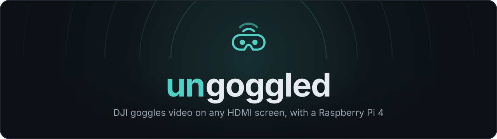
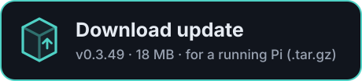

<p align="center">
  
</p>

# Download ungoggled

Current version: **v0.3.49** · [release notes](https://github.com/Joker133782/ungoggled-by-Joker133782/releases/tag/v0.3.49) · [all versions](https://github.com/Joker133782/ungoggled-by-Joker133782/releases) · [what changed](CHANGELOG.md)

<p align="center">
  <a href="https://github.com/Joker133782/ungoggled-by-Joker133782/releases/download/v0.3.49/ungoggled-0.3.49-pi4-arm64.img.xz"></a>
  &nbsp;
  <a href="https://github.com/Joker133782/ungoggled-by-Joker133782/releases/download/v0.3.49/ungoggled-0.3.49.update.tar.gz"></a>
</p>

> The files are too big to live in the repository itself, so the buttons link to
> the release on GitHub. Clicking one starts the download straight away.

## Which one do I need?

| | **Flash image** | **Update** |
|---|---|---|
| File | `ungoggled-0.3.49-pi4-arm64.img.xz` | `ungoggled-0.3.49.update.tar.gz` |
| Size | 684 MiB (717,334,376 bytes) | 18 MiB (18,907,144 bytes) |
| Use it when | Setting up a **new** microSD card, or starting over | Your Pi **already runs** ungoggled 0.3.0 or newer |
| What it does | Complete system: Raspberry Pi OS Lite 64-bit (Debian 13 Trixie) + ungoggled, Wi-Fi access point ready | Replaces the ungoggled application, keeps your settings, images, Wi-Fi and passwords |
| How | Write it to the card (below) | Upload it in the web console (below) |

Only the **Raspberry Pi 4** with **64-bit** Raspberry Pi OS (ARM64) is supported.
An update contains the whole application, so you can skip versions in between.

## Flash a new SD card

1. Download the **flash image** (you don't need to unpack the `.xz` file).
2. Write it to a microSD card of at least 8 GB. Recommended writers:
   [Raspberry Pi Imager](https://www.raspberrypi.com/software/) (Windows, macOS, Linux)
   or [Caligula](https://github.com/ifd3f/caligula) (Linux). In Raspberry Pi Imager
   choose *Use custom* as the operating system.
3. **Skip any OS customisation** the tool offers (user name, Wi-Fi, SSH): the image
   already contains its network and login setup.
4. Let the tool verify the card, put it in the Pi and power on. The first start
   expands the system to fill the card and takes a little longer.
5. Join the Wi-Fi **ungoggled** with the password **ungoggled**.
6. Open **http://192.168.50.1** and choose a password for the web console.

Wiring and hardware: [docs/INSTALL.md](docs/INSTALL.md#hardware-and-wiring).

### Default credentials

| Setting | Default |
| --- | --- |
| Wi-Fi SSID | `ungoggled` |
| Wi-Fi password | `ungoggled` |
| SSH username | `root` |
| SSH password | `ungoggled` |
| Web interface | `http://192.168.50.1` |

Change the Wi-Fi name and password in the web console, and the root password with
`passwd` if you like. Updates keep existing passwords; these defaults only apply to
a freshly flashed card. The image's Wi-Fi country is **DE**; set the right country
if you use it elsewhere.

## Update a running Pi

1. Download the **update** file on your phone or computer.
2. Connect to the Pi's Wi-Fi and open **http://192.168.50.1**.
3. Go to **System → Software update**, tap **Upload update** and choose the
   `.update.tar.gz` file (on a computer you can also drag and drop it).
4. Tap **Install now** when the Pi has checked the file. Keep the Pi powered; the page
   reconnects by itself when the update is done.

Your settings, idle screens, Wi-Fi configuration and passwords are kept. If the new
version fails its startup check, the Pi goes back to the previous one automatically.
With internet on your phone you can also use **Check for updates** in the same panel
instead of downloading the file yourself. Pis older than 0.3.0 need a one-time SSH
step first: see [docs/INSTALL.md](docs/INSTALL.md#upgrading-an-installation-older-than-030).

## Verify the download (optional)

Each file has a matching `.sha256` file on the
[release page](https://github.com/Joker133782/ungoggled-by-Joker133782/releases/tag/v0.3.49).
The SHA-256 checksums for v0.3.49 are:

| File | SHA-256 |
|---|---|
| `ungoggled-0.3.49-pi4-arm64.img.xz` | `00afb0be43f2d710d150849e1620871098914c787465c241a2516b0b6ba57d54` |
| `ungoggled-0.3.49.update.tar.gz` | `67418f56c5fc3754fd23b5a02d4fede19b2659305ffe9bb9c819b843cb9354a1` |

Windows (PowerShell, in the download folder):

```powershell
Get-FileHash .\ungoggled-0.3.49-pi4-arm64.img.xz -Algorithm SHA256
Get-FileHash .\ungoggled-0.3.49.update.tar.gz -Algorithm SHA256
```

Linux / macOS (with the `.sha256` files next to the downloads):

```sh
sha256sum -c ungoggled-0.3.49-pi4-arm64.img.xz.sha256
sha256sum -c ungoggled-0.3.49.update.tar.gz.sha256
```

(On macOS use `shasum -a 256 -c` instead of `sha256sum -c`.) The printed checksum
must match the table above. Checksums detect a damaged download, not who published
it: only install files from releases you trust.
