

  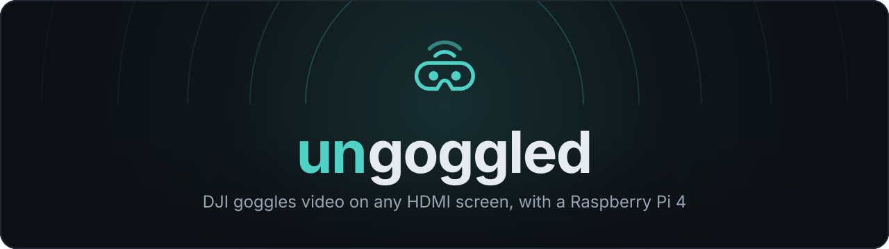

  <b>Turn a Raspberry Pi 4 into an HDMI receiver for DJI goggles</b> — so everyone at the field can watch the flight on a TV, set up from your phone.

  <a href="https://github.com/Joker133782/ungoggled-by-Joker133782/releases/latest">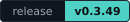</a>
  
  
  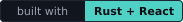

## ⬇ Download

  
  &nbsp;
  <a href="https://github.com/Joker133782/ungoggled-by-Joker133782/releases/download/v0.3.52/ungoggled-0.3.52.update.tar.gz">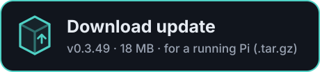</a>

  <b>Which one?</b> First time → <b>flash image</b> (write it to a microSD card). Already running ungoggled → <b>update</b> (upload it in the web console). 
  <a href="DOWNLOAD.md">Step-by-step guide &amp; checksums</a> ·
  <a href="https://github.com/Joker133782/ungoggled-by-Joker133782/releases/tag/v0.3.52">Release notes v0.3.52</a> ·
  <a href="https://github.com/Joker133782/ungoggled-by-Joker133782/releases">All versions</a>

  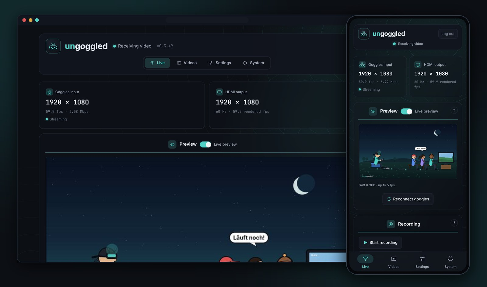

## What is it?

DJI goggles can send their live video out over USB-C. **ungoggled** receives that
stream on a Raspberry Pi 4, decodes it in hardware and puts it on any HDMI screen —
a TV, a monitor or a capture card. The Pi opens its own Wi-Fi, and a web console on
your phone shows what is going on and lets you set everything up. No app, no cloud,
no internet needed at the field.

  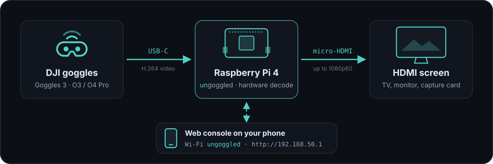

## Features

<table>
<tr><td width="56" align="center"></td><td><b>Live HDMI output</b> Hardware-decoded, automatic 1080p, or any mode your screen offers (incl. interlaced).</td></tr>
<tr><td width="56" align="center"></td><td><b>Web console, phone first</b> Status, live preview and every setting from your phone. Password-protected, installable as an app over HTTPS.</td></tr>
<tr><td width="56" align="center"></td><td><b>Idle screens</b> Three built-in animated waiting screens, or your own image or looping video.</td></tr>
<tr><td width="56" align="center"></td><td><b>USB action-cam player experimental</b> Play clips from a USB drive or action camera on the TV, with stretch-to-fill.</td></tr>
<tr><td width="56" align="center"></td><td><b>Recording experimental</b> Auto-record every flight, a 30-second crash buffer, or record by hand, without re-encoding.</td></tr>
<tr><td width="56" align="center"></td><td><b>Spectator stream experimental</b> Bystanders watch in their phone's browser on the Pi's Wi-Fi, with QR codes to join.</td></tr>
<tr><td width="56" align="center"></td><td><b>Safe updates</b> Update from the browser; settings are kept and a failed update rolls back by itself.</td></tr>
<tr><td width="56" align="center"></td><td><b>Own Wi-Fi</b> 5 GHz access point out of the box, or join an existing network.</td></tr>
<tr><td width="56" align="center"></td><td><b>Beeper, LEDs, power button</b> Optional GPIO buzzer tones, three status LEDs and a shutdown button.</td></tr>
<tr><td width="56" align="center"></td><td><b>Last 30 minutes</b> Bitrate, frame rate, temperature, CPU, RAM, Wi-Fi and SD-card graphs.</td></tr>
</table>

## Screenshots

  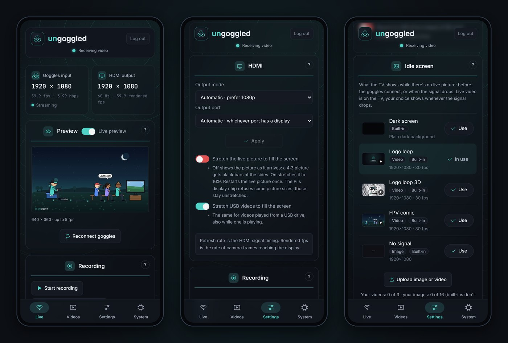

<b>More screenshots</b> (USB player, recordings, updates, graphs)

 

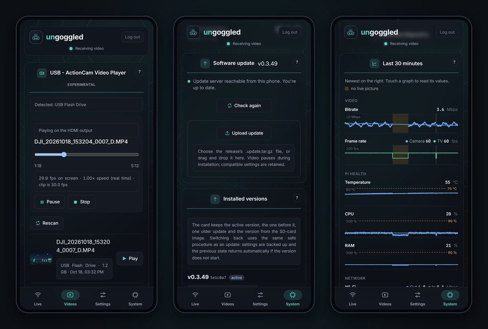

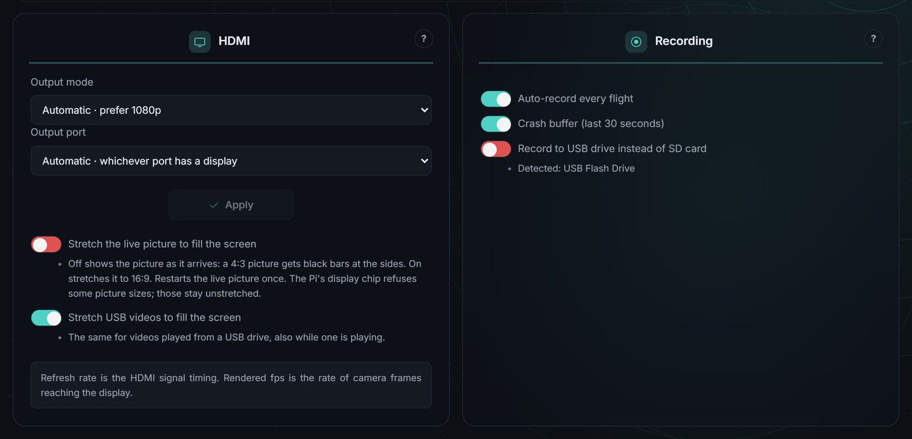 <b>Settings → HDMI and Recording</b>

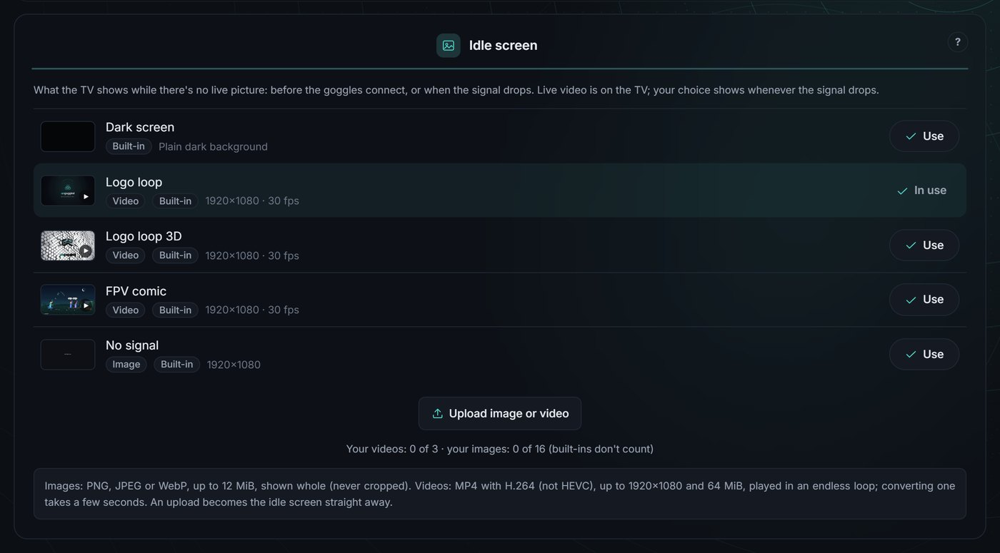 <b>Settings → Idle screen</b>

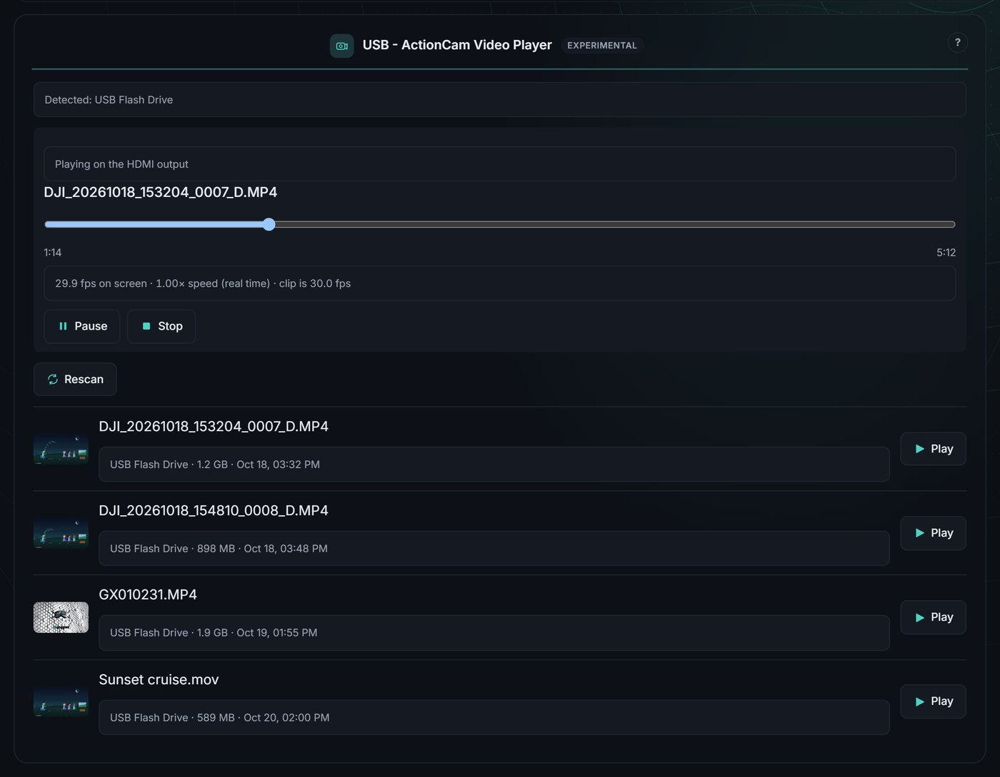 <b>Videos → USB action-cam player</b>

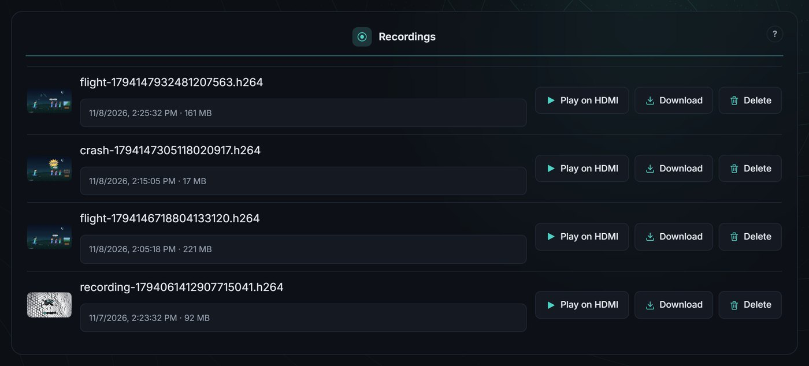 <b>Videos → Recordings</b>

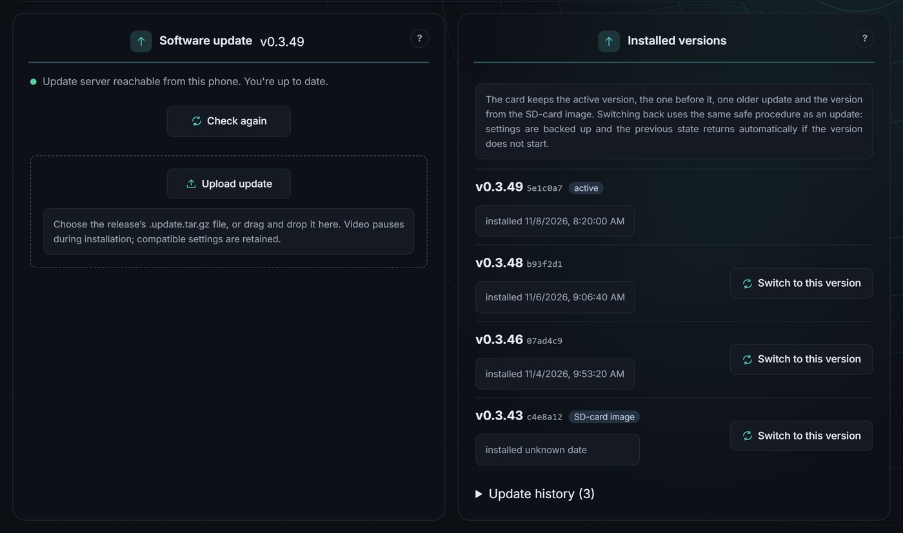 <b>System → Software update and versions</b>

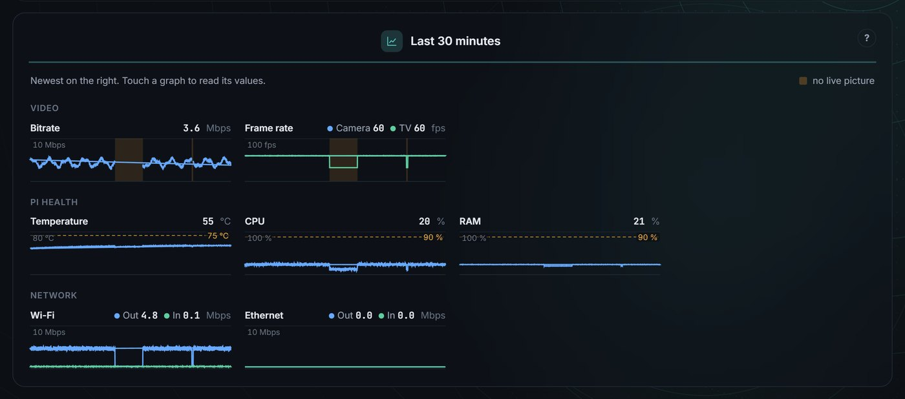 <b>System → Last 30 minutes</b>

Screenshots use made-up demo data.

## Idle screens

What the TV shows while there is no live picture — before the goggles connect, or
when the signal drops. Three animated screens are built in (*Logo loop*, *FPV comic*,
*Logo loop 3D*); you can also upload your own image or video.

  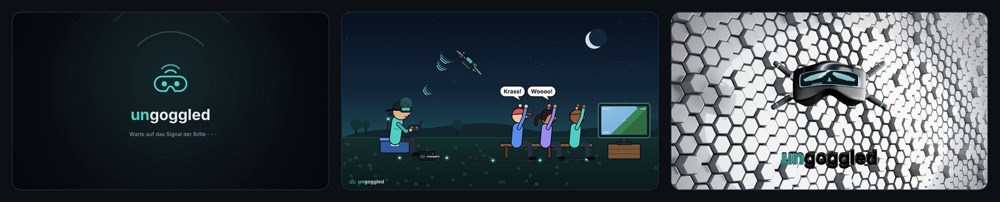

## Supported goggles

| Goggles | Air unit | Status |
|---|---|---|
| **DJI Goggles 3** | O3 Air Unit, O4 Air Unit Pro | ✅ Tested with live HDMI output |
| DJI Goggles 2 | — | 🧪 Experimental; only the Goggles 3 path is hardware-verified |
| DJI FPV Goggles V1/V2 | — | 🧪 Experimental, unverified: has not run against real V1/V2 hardware |

Other systems (for example Walksnail or DJI Goggles N3) have not been tested. Details: [docs/GOGGLES.md](docs/GOGGLES.md).

## Quick start

You need a **Raspberry Pi 4**, a microSD card (8 GB or more), a USB-C data cable,
a micro-HDMI cable, the goggles with a paired air unit, and a separate power supply
for the Pi.

1. **Flash** the [image](DOWNLOAD.md) to the microSD card (Raspberry Pi Imager or
   Caligula; skip any OS customisation) and put it in the Pi.
2. **Wire it up:** goggles USB-C → **Pi USB-C** port, screen → **HDMI0** (next to
   the USB-C port). Power the Pi separately (GPIO supply or PoE), then switch on.
3. **Join the Wi-Fi** `ungoggled`, password `ungoggled`.
4. **Open http://192.168.50.1** and choose a password for the web console.

For clean video without the goggles' on-screen display, set **Settings → Camera →
Advanced Camera Settings → Camera View Recording → OFF** in the goggles.
SSH login on a fresh image: `root` / `ungoggled` — see
[DOWNLOAD.md](DOWNLOAD.md#default-credentials) for all defaults.

## Documentation

| Page | What's inside |
|---|---|
| [**DOWNLOAD.md**](DOWNLOAD.md) | Which file you need, flashing, updating, checksums |
| [**docs/INSTALL.md**](docs/INSTALL.md) | Hardware and wiring, SD-card image, updates and version switching, manual install on Raspberry Pi OS |
| [**docs/USER-GUIDE.md**](docs/USER-GUIDE.md) | The web console: HDMI, idle screen, preview, Wi-Fi, HTTPS, USB player, recording, spectator stream, beeper and LEDs |
| [**docs/GOGGLES.md**](docs/GOGGLES.md) | Goggles 3, Goggles 2 and V1/V2 details and settings |
| [**docs/DEVELOPMENT.md**](docs/DEVELOPMENT.md) | Building from source, releases, services and files |
| [**CHANGELOG.md**](CHANGELOG.md) | What changed in each version |

## Credits and license

*ungoggled by Joker133782* is a fork of
[TimoLehnertz/ungoggled](https://github.com/TimoLehnertz/ungoggled), licensed under
the MIT license (see [LICENSE](LICENSE), Copyright (c) 2026 Timo Lehnertz).
Protocol research credits and third-party licenses are in
[THIRD_PARTY.md](THIRD_PARTY.md); the built-in idle-screen videos are original to
this project and MIT licensed.

Independent project, not affiliated with DJI or Cosmostreamer.
